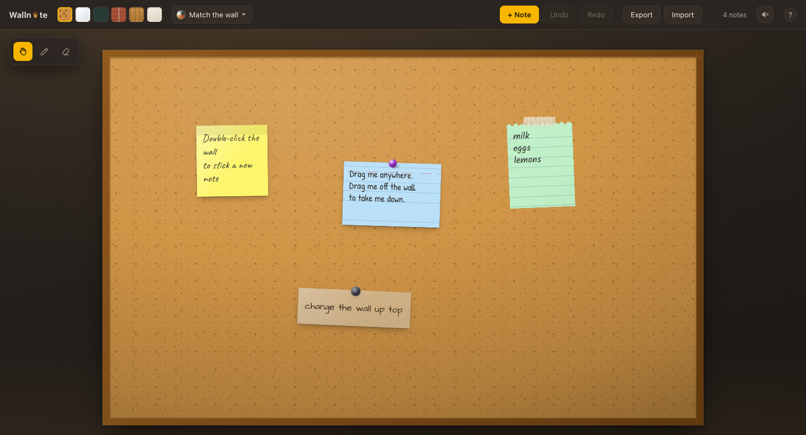

# Wallnote

A wall. You stick notes on it. That's the whole pitch.



No accounts, no backend, no database, no cloud, no "sync". Your wall lives in your
browser's localStorage and nowhere else. Close the tab, come back next week, everything
is exactly where you left it.

## Get it running

```bash
npm install
npm run dev
```

That's it. No `.env`, no services to spin up, nothing to sign up for.

## What you can do

**Stick notes up.** Double-click the wall. Type on the paper itself — no dialog, no side
editor, the caret just lands on the note in handwriting.

**Move them around.** Drag anywhere. Grab one and it comes to the front, like paper does.

**Bin them.** Drag a note off the wall, or straight into the waste-paper basket in the
corner, and it's screwed up into a ball and lobbed in. Changed your mind? Click the bin and
fish it back out, smoothed flat, right where it was.

**Make them yours.** 8 paper colours × 6 stocks (sticky, index card, torn notebook, kraft,
graph, ripped scrap) × 6 shapes × 4 fasteners (pushpin, washi tape, magnet, or bare with a
curled corner) × 4 handwriting fonts. Every note gets a small random tilt so the wall
looks assembled by a human rather than a CSS grid.

**Change the wall.** Cork, whiteboard, chalkboard, brick, wood, plaster. All drawn in CSS
and SVG — there isn't a single image asset in the repo.

**Change the room.** The wall hangs in a lit room, and you can repaint it: warm taupe,
cool slate, forest, plum, clay, ink, or sand. Leave it on *Match the wall* and the room
picks up the colour of whatever the wall is made of.

**Tie them together.** Pick up the red string (`S`), press on one note and pull to another.
The yarn sags under its own weight and follows the notes when you move them. Click a string
with the tool up to cut it. Every wall wants to be a detective's corkboard eventually.

**Turn the light off.** A bulb hangs in the room. Click it to pull the cord, or press `L`.
Each wall's room has its own bulb, and switching it back on, it stutters into life the way
an old incandescent does. What's left with it off depends on the real time of day, from the
window off to the right: daylight at noon, low gold around sunset, faint cool moonlight at
night, where white paper still reads and colours mostly don't.

**Bring a torch.** In a dark room your pointer carries a torch, and the beam swings after it
like a hand-held light.

**Glow paper.** One stock is phosphorescent. Pale in the light; in the dark it shines in its
colour, brightest just after the light goes out and fading over the next minute, like the
stars on a kid's ceiling. Add `?hour=22` to the URL to see night at noon.

**Have more than one.** The wall's name in the toolbar is a picker: switch walls, rename
them, take one down, or put up a new one. Each wall keeps its own surface, room, notes, ink
and undo history.

**Draw on it.** Grab the pencil from the palette top-left. Scribble anywhere — the ink
goes *under* the notes, because that's where ink goes. Eraser rubs out whole strokes.

**Hear it.** There's a speaker button in the toolbar. Paper crumples, pins click into
cork, tape rips, magnets clack. Every sound is synthesised with the Web Audio API — no
audio files either. Off by default, because nobody likes a website that starts making
noise at them.

## Shortcuts

| | |
|---|---|
| `V` / `P` / `E` / `S` | Hand / Pencil / Eraser / String |
| `L` | Light switch |
| `⌘Z` / `⌘⇧Z` | Undo / Redo |
| `Delete` | Take the selected note off the wall |
| `Esc` | Stop writing, back to the hand |
| Double-click wall | New note |
| Double-click note | Write on it |
| Drag corner | Resize |
| Right-click note | Duplicate, send to back, remove |
| Drag note to note | Tie red string (string tool) |
| Click the bin | Fish a note back out |

There's a `?` in the toolbar that shows all of this, in case you forget.

## Bits we're quietly pleased about

**The wall is 1600×1000 made-up units**, CSS-scaled to fit whatever window you've got.
Notes store their position in those units, so resizing the browser never nudges anything —
your tidy cluster stays a tidy cluster.

**One light source.** Every shadow in the app — notes, pushpin domes, the wall itself —
derives from the same CSS custom properties. Shadows pointing different directions is the
fastest way to make something look fake. The bulb hangs exactly where that light was always
coming from.

**Dragging never touches React.** Pointer moves write `transform` straight to the DOM node
and only commit to state on release, which is why it stays smooth with a hundred notes up.

**Ink is SVG, not canvas.** Vector paths stay crisp at any zoom and survive a window
resize untouched, where a canvas would need its backing store rebuilt every time.

## Your data

It's in `localStorage`. Each wall sits under `wallnote:wall:<id>`, and `wallnote:walls` lists
them. All of it is a single "clear browsing data" away from oblivion. **Export** downloads the
current wall as JSON. **Import** brings a file back as a new wall. Do that occasionally if a
wall matters to you.

If you used Wallnote before it had multiple walls, your old wall (`wallnote:v1`) moves over
as "My wall" the first time you open it.

Drawing is the one thing that can fill up the quota — if it ever does, the app tells you
rather than silently dropping your strokes.

## Install it

Wallnote is a PWA. Open it, hit install in your browser, and it lands in your dock or on
your home screen with the acorn icon and runs full-screen and fully offline. It never
needed the network anyway.

```bash
npm run build && npm run preview   # service worker only runs in a real build
```

## Scripts

| | |
|---|---|
| `npm run dev` | Dev server |
| `npm run build` | Typecheck + production build |
| `npm run preview` | Serve the build (use this to test PWA/offline) |
| `npm run icons` | Regenerate app icons from `public/icon.svg` |

## Built with

React, TypeScript, Vite, `vite-plugin-pwa`, and a slightly unreasonable amount of CSS.

---

*The acorn is the "o". Yes, it's a wallnut. We know.*
